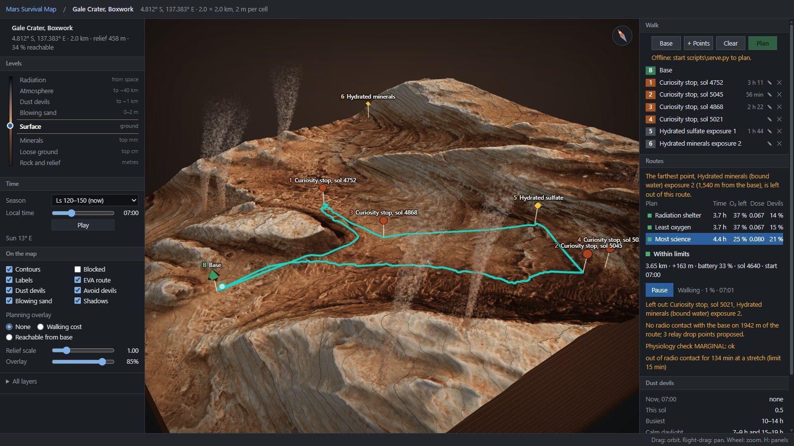

# Martian Map — plan a safe walk on Mars, on real data

Our entry for the NASA Space Apps Challenge 2026, *Interplanetary Survival Guide: Martian Map*.

An astronaut stepping out on Mars needs to know more than where the rocks are: how steep the
way is, where the boots sink into sand, where the radiation is lower, when dust devils rise, how
much oxygen and battery the walk takes, and whether a tired body can still make the last climb.
This project builds that map from real NASA data, plans the walk on it, and shows everything in
a 3D view of the site that runs in a browser.



## What it can do

### Real Mars, mapped
- **Three sites built from NASA archives**, 2 × 2 km at 2 m per cell: Gale crater's boxwork
  ridges (Curiosity), the Jezero river delta (Perseverance) and Nili Planum. A new site is one line
  of code and two commands.
- **About thirty layers per site**: HiRISE terrain and photos at 1 m, CRISM minerals, THEMIS
  thermal inertia, slope, roughness, ridges and troughs, walking cost, the area reachable from the
  base, science score; weather (REMS, MEDA) and radiation (RAD) per sol.
- **Loose sand** read from the photo and the terrain (dark smooth sheets in lows, ripple fields),
  checked against THEMIS: 17 % of the Jezero site, 1 % of Gale.
- **Radiation at the ground**: the measured dose of the sol spread over the terrain; next to
  cliffs part of the sky is hidden and the dose is up to 12 % lower.
- **A dust devil forecast** per season and hour from our own model, trained on vortex catalogs of
  InSight and Perseverance and on vortices we detected in Curiosity's pressure record.

### A walk planned like a mission planner would
- **Three plans for any base and points** you click on the map: *radiation shelter*, *least
  oxygen*, *most science*. Each says time, distance, climb, oxygen, battery, dose and dust devil
  risk, which targets it left out and why.
- **Real walking physics**: metabolic cost of every step (Pandolf), boot sinkage in loose ground
  (Bekker), slope limits, the suit's oxygen and battery with reserves.
- **A physiology check**: every plan is walked through a simulator of the crew member (fatigue,
  heat, water, heart rate, return oxygen, emergency reach). Where it gets stuck, the planner closes
  that spot or drops the least valuable stop and plans again.
- **Dust devils with a clock**: every leg is routed with the risk of the hour it will be walked,
  and the planner picks **the start time** that keeps the risk low (at Gale it cuts the expected
  encounters by about 40 %, at Jezero by half).
- **Live dodging**: during the walk a vortex heading for the route makes the astronaut stop; the
  planner finds a way around in about a second, and the page chooses whichever loses less time:
  wait for it to pass, or go round.
- **Radio**: line of sight to the base mast along the route, with relay drop points.
- **Emergency shelter** from a solar particle event: the nearest spot that cuts the dose.
- **On foot or by rover**: the same planner drives a wheeled rover with its own model (wheel
  sinkage, motor power, battery, solar panels, regenerative braking), drawn as a simplified
  Perseverance.

### A 3D map you can read at a glance
- **The site in 3D** with soft shadows from the Sun of the chosen hour, contours and the cut
  block showing the rock layers. Night looks like an overcast evening.
- **From the sky to the rock**: one column of levels. The surface in the middle shows everything;
  going up adds blowing sand, dust devils with their tracks, the atmosphere and the radiation map;
  going down shows minerals, loose ground and the relief.
- **Animated hazards**: dust devils rise where the risk map expects them and at the rate the
  forecast gives for the hour; sand drifts in veils over the mapped sand.
- **The walk on the map**: the astronaut (or the rover) walks the route once with a clock,
  Pause / Go again, and a progress bar while the planner works.
- **A globe** to pick the site from, made for an iPad.

## Try it

The built maps and plans are in the repository, so this is all it takes:

```bash
python -m venv .venv
.venv\Scripts\pip install -r requirements.txt
.venv\Scripts\python scripts\serve.py
```

Open http://127.0.0.1:8770/gui/ and pick a site, or open a map directly:
http://127.0.0.1:8770/data/jezero_delta/view3d.html

In the map:
1. **+ Points**, then click the map where to go (**Base** moves the base). **Plan** asks the
   planner; in 20–35 s the plans for the walk and the rover come back.
2. Pick a plan in **Routes**: the route, its numbers and the dust devil chance.
3. Move through the **Levels** on the left; drag the **Time** slider or press **Play**.
4. **Send one across the route** (Dust devils box) to see the astronaut dodge.

Without `serve.py` (a page opened as a file) everything works except planning new points; the
**Example walk** link shows a precomputed one. Links can carry the view:
`view3d.html#walk=example&level=devils&devils=8`, `#cam=az,el,r,x,z`, `#hour=21`.

## Build a site from NASA data

```bash
.venv\Scripts\python scripts\ingest_region.py --region jezero_delta --rad-sols ""   # download (minutes)
.venv\Scripts\python scripts\build_site.py --region jezero_delta                    # fuse into a Site
.venv\Scripts\python -m mars_map.pipeline --site data/jezero_delta --shelters        # plan the EVA
.venv\Scripts\python scripts\view3d.py data/jezero_delta                             # the 3D page
```

The default region is `gale_boxwork`; its radiation needs `--rad-sols 4640-4669`. The dust devil
forecast comes from `python -m hazards.train_dust_devils` (see [hazards/README.md](hazards/README.md)).
No internet: `scripts\make_stub_site.py` makes a synthetic site in seconds.

## How it fits together

```
NASA archives ──▶ data pipeline ──▶ Site ──▶ environment ──▶ planner ──▶ eva_plans.json ──▶ 3D page
(HiRISE, CTX,     catalog, fetch,   layers,   sunlight,       routes,       three plans       view3d.html
 CRISM, THEMIS,   reproject, fuse,  series,   shadows,        physiology,   per vehicle       + serve.py
 REMS, RAD, MEDA) sand, minerals    targets   radiation,      dust devils,                    (live planning)
                                              temperature     radio
                    hazards/ (dust devil forecast) ─────────────▲
```

| Folder | What is in it |
|---|---|
| [`mars_map/catalog`, `mars_map/ingest`](DATA.md) | what exists in the archives, download only the region, reproject to the site grid |
| [`mars_map/fusion`](DATA.md#part-b--fusion-and-interpretation-mars_mapfusion-mars_mapanalysis) | finest source per cell, sand, minerals, science score, walking cost, base and targets |
| `mars_map/environment.py` and friends | sunlight, shadows, radiation and temperature maps for a sol and hour |
| `mars_map/astronaut_router.py`, `pipeline.py` | the planner: graph search, target choice, strategies, dust devils, repair loop |
| `mars_map/rover.py` | the rover as a second traveller for the same planner |
| `mars_map/dust_devils.py` | dust devil risk by place and hour, exposure of a walk |
| `mars_eva_sim/` | the crew member simulator (physiology, life support) and its tests |
| `hazards/` | the dust devil forecast: labels, climate inputs, model, product CSV |
| `mars_map/viewer/`, `scripts/view3d.py` | the 3D page and its builder |
| `scripts/serve.py` | the app server: pages plus `/api/plan`, `/api/reroute`, `/api/progress` |
| `gui/` | the globe |
| `data/<site>/` | built sites: `site.json`, `eva_plans.json`, `view3d.html` (and `layers.npz`, not in git) |

## Documentation

| File | About |
|---|---|
| [EVA_PLANNER.md](EVA_PLANNER.md) | the planner: strategies, physics, physiology check and repair, dust devils, rover, JSON |
| [DATA.md](DATA.md) | the data: regions, layers and sources, file formats, ingestion and fusion |
| [DATA_CONTRACT.md](DATA_CONTRACT.md) | the `Site` every part reads |
| [ENV_MAPS.md](ENV_MAPS.md) | sunlight, radiation and temperature maps |
| [hazards/README.md](hazards/README.md) | the dust devil model, how it was tested, its weak points |
| [gui/README.md](gui/README.md) | the globe |
| [scripts/serve.py](scripts/serve.py) | the app server API (in the file header) |

Tests: `.venv\Scripts\pip install pytest`, then `.venv\Scripts\python -m pytest mars_eva_sim`
(181 tests, about 1.5 minutes).

## What to keep in mind

- **The numbers are working assumptions where nobody has measured them**: suit and crew limits,
  rover parameters, the walking cost weights. They are named in one place each and documented.
- **Sand and the dust devil risk map are interpretations**: read from images and physics, not
  measured on the ground. They rank places; the forecast and the measurements set the levels.
- **The dust devil forecast is a climatology**: how many vortices on a typical sol of the season,
  not on a given day. At Gale it is calibrated on Curiosity's own count.
- **Jezero and Nili Planum have no measured radiation** (Perseverance carries no detector); their
  dose uses a typical Gale value and the map says so.
- **The vortices on the map are an illustration** of the forecast: their number follows it, their
  exact paths are random. Nothing detects real dust devils.
- **Nili Planum is coarse** (20 m terrain, no HiRISE) and its page predates the newest features.

## What is next

- A region analyzer and rating, to choose landing sites automatically.
- Dust storms and solar particle events as forecasts, like the dust devils.
- Helmet mode for the GUI.
- Real limits for the suit, the crew and the rover from the research questions.
- The full Perseverance weather archive (the public feed has four sols).

## Team workflow

Branches by role: `Data`, `Alg`, `GUI`; finished work goes to `main`. Shared files
(`mars_map/site.py`, `mars_map/grid.py`, `catalog/schema.sql`, `requirements.txt`) change only by
agreement. Before rebuilding the map pages, pull first: the pages are built from the code and
data on your machine.
